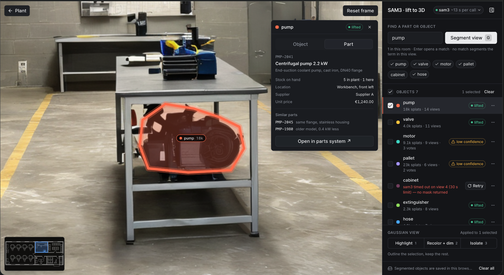

# world-parts

**What does a 3D world become when you attach your own data to its objects?**

A design pass built on top of [risenW/segment-3gs](https://github.com/risenW/segment-3gs) — a Gaussian-splat segmentation playground on [SpAItial](https://spaitial.ai) worlds, where you segment an object once and it lives in 3D from then on. The pipeline there is real. This repo is the surface around it: the segmentation is mocked, the question is what a maintenance engineer does with a segmented world once their parts data hangs on it.

**Live: [world-parts.vercel.app](https://world-parts.vercel.app)** · Built in a day, prototype only. Not affiliated with SpAItial.



## The question

`segment-3gs` says in its own README that it is "a starting point to fork, not a product". Two things keep it a demo:

1. **A segmented object knows its own geometry and nothing else.** For a real-estate visitor that's fine. For the other persona — a team that integrates worlds into their own product through the API — the object is only useful once their data hangs on it: what it is, what's in stock, what replaces it.
2. **One world is one room.** A plant has many; only some are scanned. The interface has to be honest about which rooms can answer "where is it" in 3D and which can only answer from the inventory list.

So the prototype starts from the plant, not from the viewer: search for a part, see which rooms have it and how precisely, walk into the scanned one, and find it framed with its parts record open. The scene is a factory workshop because that's where the question is sharpest.

## What's here

- **Parts list** — the start screen: part number, name, stock, location and status (`low · idle · installed only`), filters, sorting, and a detail drawer with stock by location, which equipment the part is installed in, substitutes and similar parts with the reason, and *Also known as*: the names the same part carries in the ERP, a datasheet or an invoice, merged into one record. Every location is a link: into the room if it's scanned, onto the plan if it's inventory only.
- **Plant overview** — a floor plan with five rooms (one `scanned`, four `not scanned`), a search field that takes a name or a part number, and results grouped by room: `in world` (exact object, click to enter) or `inventory only` (location as text, "scan this room to locate parts in 3D"). Pinch-to-zoom and drag on mobile. The plan is a blueprint (navy paper, grid, walls and furniture at two weights), the same drawing as the room minimap, and it fits the building rather than the whole image, so the building fills the screen.
- **Room** — the workshop scene with segmented objects as overlays and tracking labels; entering from a search result frames the object and opens its card. A blueprint minimap top left shows where you stand and where you look: a dot and a view cone, fixed for the still frame and following the camera in Live 3D. In Live 3D, three viewpoints (entrance, centre aisle, by the cabinet) are rings on the plan; click one to walk there. Find puts an amber pin on the found object. The live world is mapped onto the plan with two measured points per room; the world was generated from a photo and the plan drawn separately, so x and z get their own scale and the cone goes through the same mapping. The breadcrumb returns to the plant. The minimap sits under it: drag the header to move the card, S, M and L change its size, and the zoom buttons crop the plan around the room. Collapse it to an icon. Position, size, zoom and collapsed state stay in this browser. Double-click the header, or Enter while it is focused, to put it back under the breadcrumb. On a narrow screen it keeps the small size and offers drag and collapse, and it stays above the object sheet. 300 ms zoom-and-fade between levels, static swap with reduced motion.
- **Segmentation panel** — concept input (and what it can't do), object list with explicit states (`lifted · low confidence · failed` with a reason and Retry), multi-select, Gaussian view as a three-way switch, server status pill with latency.
- **Rooms and doors** — four spaces are scanned: workshop, storeroom, production hall and the corridor that joins them. Each has its own SpAItial world, still frame, objects and minimap calibration. In the corridor the doors are drawn on the still and labelled (`→ Storeroom`); every room has a `→ Corridor` button, since its own door is behind the camera. Office and loading bay have no capture yet, so their doors say "not scanned". Search runs across all rooms: a part on a storeroom shelf opens rack R3 at shelf 2, a belt fitted in the CNC machines opens the production hall.
- **Live 3D** — a `Still · Live 3D` switch in the room. Live loads the SpAItial world as a SOG splat in PlayCanvas: drag to look, scroll or pinch to zoom, right-drag to move. "Find" and "Find spare" fly the camera to the object and turn it a little so the object clears the card. Controls are a one-line hint that fades after the first drag, plus a non-modal panel on `?`. The still frame stays the default and the fallback (loading, error, no WebGL). See *Running the live world* below.
- **Objects in the 3D world** — the still's labels (dot, name, splat count) pinned to each object's splats, so they stay on the object from any angle. Hover one and the object's splats light up in its colour, in the shape of its still-frame mask, while the rest of the world dims; click it and the camera flies there and the card opens. The found object's label pulses. How: the still's masks are lifted onto the world. Every splat is projected into the still with the still's own camera (calibrated by overlaying the still on the render); a splat is part of an object when it lands in the object's mask at the object's depth, so the wall behind the cabinet stays dark. Limit: sides the still never saw aren't in any mask.
- **Substitute instead of a dead end** — when a part in a unit has no spare (the impeller in pump P-104), the card says so and offers a stocked part that does the same job, with the reason, and **Find substitute** takes you to its bin. Matches are labelled `exact duplicate · functional substitute · related`, and `related` is never offered as a swap. The substitute here has sat idle for 13 months, so using it is also the reuse case.
- **Object card** — *Object* (splats, views, confidence) and *Parts in this unit* on equipment, with a "Find spare" action that frames the cabinet; *Bins* on the cabinet, a 2×3 grid with the searched bin highlighted.
- Desktop and 375 px, keyboard for everything that isn't the camera (`/` search, `G` segment, `Esc` back, `↑/↓`, `1/2/3`), reduced motion respected, state in the URL so a link opens the same view.

Vocabulary is kept from the original project — concept, segment view, lift, views, votes, Gaussian view, isolate — so this can be read next to its code.

## Design decisions

1. **Start from the plant, not the viewer.** The engineer's question is "where", and the answer has two precisions: in world, or inventory only. Both are shown; neither pretends to be the other.
2. **Not scanned is a state, not an absence.** Four rooms say so, and say what scanning would give them.
3. **Low confidence is a state, not a hidden number.** An object with too few votes says so and why.
4. **The part layer is additive.** Everything works without a part attached; nothing in the world layer depends on it.
5. **Equipment and parts are two levels.** The world segments equipment (pump P-104, cabinet CAB-01); parts are records that are *installed in* equipment or *stored in* a bin, rack or spot. Search answers both.
6. **All values from `lib/data.ts`.** Rooms, equipment, parts, inventory rows, timings. No real brands, no real part numbers.

## How this maps to segment-3gs

Honest split: what here mirrors the real pipeline, what is mocked, and what the parts layer would need from it.

**What is real here and what is mocked**

| world-parts | segment-3gs | Here |
|---|---|---|
| Room scene | PlayCanvas viewer on a `.ply` splat exported from SpAItial | **Still frame** of a SpAItial world (Echo-2, image to world) by default; **Live 3D** renders the same world's SOG export with PlayCanvas |
| Camera to object | — (orbit only) | Hand-placed camera pose per object: target from the splat centers inside each object's still-frame polygon, projected with the still's camera |
| Object highlight in 3D | Per-splat masks from the lifted segmentation | Still-frame masks lifted onto the splats: project each splat with the still's camera, keep the ones in the mask and the object's depth band. Tint in a PlayCanvas `setWorkBufferModifier`, re-run only when the focus changes |
| Concept input, "needs a concept" | `POST /segment` with `prompts.text`, one concept per call | Mocked: no server call, results come from `lib/data.ts` |
| Server pill `mock · mobile_sam · sam3` | `GET /health` and the model tiers | Mocked, including "simulate unreachable" |
| Object states `lifted · low confidence · failed` | `liftMask` plus per-Gaussian voting in `SegmentationRegistry` | Mocked; `VOTE_THRESHOLD = 4` mirrors the idea that one view is not enough |
| `splats`, `views`, `votes` on the object card | `splatIndices`, `sourceViews`, vote counts | Hand-written numbers |
| Gaussian view `Highlight · Recolor · Isolate` | `SelectionViz` and `GsplatRecolor` | 2D overlay on the still frame |
| Object outline and framing | Point-cloud highlight and camera focus | Hand-placed polygons in `lib/data.ts` |
| **Parts layer**: equipment, parts, bins, `in world` vs `inventory only` | Not in segment-3gs | **New here.** This is the design question of the repo |

**The join.** A segmented object can carry an `assetId`. That id links it to an equipment record, and parts are records *installed in* equipment or *stored in* a bin. The world layer never depends on the parts layer.

**What the parts layer would need from the pipeline**

1. **Stable object ids.** Today objects are merged by label and overlap, and they live in one browser's `localStorage` (`segmentation.objects.v2`). Parts data needs an id that survives re-segmentation, a vote merge and a reload on another machine.
2. **A place for metadata on the object.** Either a free `metadata` field on the stored object, or an external key such as `assetId` that the registry carries through merges.
3. **Server-side persistence per world.** The same world should open with the same objects for everyone on the team, not only in one browser.
4. **A focus API.** Given an object id: its bounds and a camera pose to frame it. That is what "find the part" needs in 3D: walk into the room and land on the pump.
5. **Confidence as data.** `votes` and the score next to the object, so the UI can say "low confidence" instead of hiding it.

## Deliberately not built

Real segmentation · true 3D masks: Live 3D lifts the still's 2D masks, so only what the still saw is highlighted · batch sweep · parts search beyond the 13 demo records · real harmonization or similarity: aliases and matches are hand-written demo data · procurement, suppliers, ordering · auth · persistence beyond this browser.

## Next

- The batch sweep as an honest wait: cost before start, progress, cancel that keeps results.
- Live world: object labels anchored in 3D.

## Running the live world

The world file is `public/splats/workshop.sog` (24 MB), committed so the live site can load it. It was generated on SpAItial's free plan, whose terms allow personal, non-commercial use; it is published here as part of a non-commercial portfolio prototype. To use another world, point `NEXT_PUBLIC_SPLAT_URL` at it.

```bash
pnpm install
pnpm dev
```

Open `/?room=workshop` and switch to **Live 3D**. If the file can't load, Live 3D says so and offers the still frame.

## How it was built

v0 for the first version, then one review round per commit. `AGENT_LOG.md` lists every round: what the agent produced, what it got wrong, what I changed by hand.

## Stack

Next.js · TypeScript · Tailwind · shadcn/ui · PlayCanvas (live world, loaded on demand). No backend. Code: MIT. The SpAItial world and its still frame are not covered by the MIT licence.

## Credits

[risenW/segment-3gs](https://github.com/risenW/segment-3gs) for the pipeline, the vocabulary and the honest README this builds on. [SpAItial](https://spaitial.ai) for the worlds — the workshop scene was generated in SpAItial (Echo-2, image to world) from an AI-generated reference photo. Floor plan: AI-generated reference.
